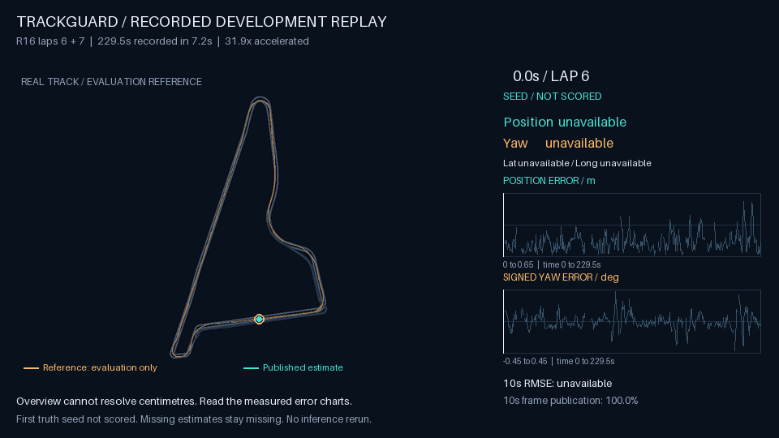

# TrackGuard

**Vehicle localization from the cameras you already run.**

TrackGuard combines seven calibrated cameras, a reference map and motion signals into a vehicle pose feed. When geometric evidence is insufficient, it emits an explicit unavailable state so the consuming system can choose its fallback.



*Accelerated replay of the sealed R16 development run. Reference and estimate follow the real track; missing outputs remain gaps. Reference truth is used only for evaluation.*

## Measured performance

| Evaluation | Position RMSE | Lateral RMSE | One-second coverage |
|---|---:|---:|---:|
| Development lap 6 | **15.34 cm** | **8.59 cm** | **95.0%** |
| Development lap 7, continuous state | **19.59 cm** | **13.91 cm** | **95.5%** |
| Separate 131-second stress window | 18.48 cm | 9.95 cm | 72.0%, below target |

The combined development run published **411/460 frames**, with **49 unavailable**. Position RMSE was 17.48 cm and p95 error was 31.95 cm. One-second coverage and published-frame fraction measure different things.

These are consumed, same-session development results with one initial truth seed. The day-session blind test never initialized: 0/148 published poses, no supplied seed and no labels for RMSE. Live or GPU performance is unmeasured. The 0.20 m nominal uncertainty threshold is not an error guarantee.

## Explore

- [Interactive track replay and performance dashboard](https://livingpixel-pixel.github.io/trackguard-localization/): scrub through position, yaw, lateral and longitudinal errors, with rolling RMSE and availability.
- [Six-slide business pitch](https://livingpixel-pixel.github.io/trackguard-localization/slides/trackguard-pitch.pdf), [editable PowerPoint](https://livingpixel-pixel.github.io/trackguard-localization/slides/trackguard-pitch.pptx) and [browser slides](https://livingpixel-pixel.github.io/trackguard-localization/slides/slides.html)
- [Engine and input contract](docs/ENGINE.md)
- [Metric definitions and limits](docs/EVIDENCE.md)
- [Replay data and rendering contract](docs/REPLAY.md)

Open the dashboard locally with `python -m http.server 8000`, then visit `http://localhost:8000`.

Run the portable engine on generated images:

```sh
python -m pip install .
trackguard synthetic
```

The synthetic example exercises SIFT, three-camera BODY geometry and causal fusion. It is a software check, not accuracy evidence.

## Pilot fit

For autonomy teams operating on a mapped course, TrackGuard offers a camera-based localization signal to evaluate alongside their existing stack. A pilot should test a separate session, a declared initial-pose protocol, missing-camera behavior and end-to-end latency on target hardware. Cost savings and deployment readiness remain to be established.

The repo includes portable algorithm source and synthetic checks. Reproducing the private benchmark requires permitted reference data, calibration, motion conventions and the original evaluation protocol. No restricted dataset is distributed.
